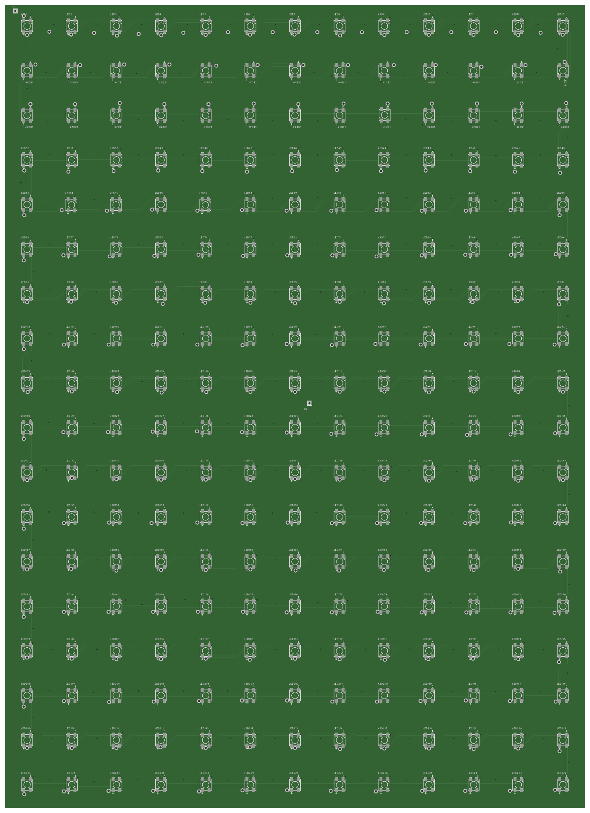
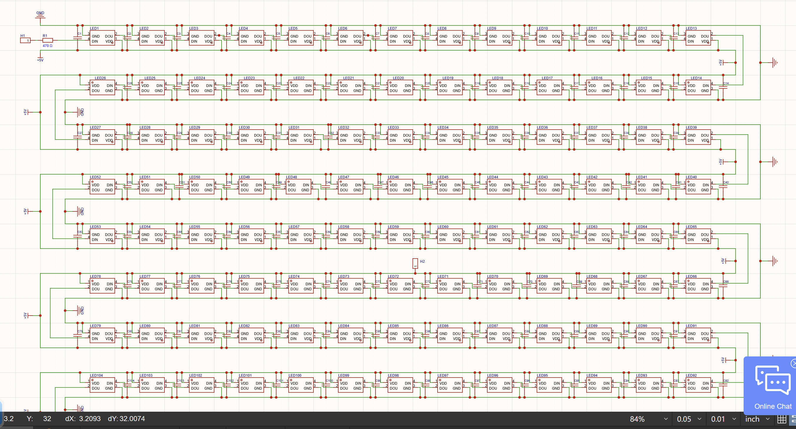
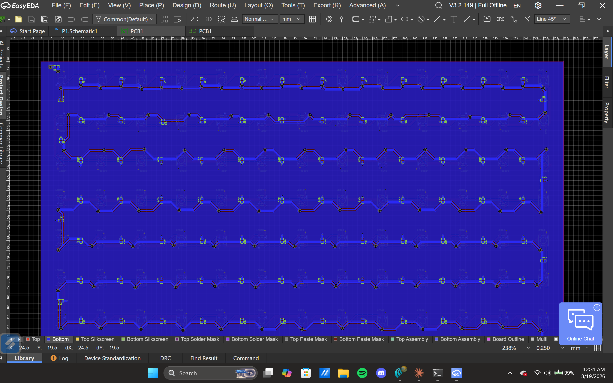
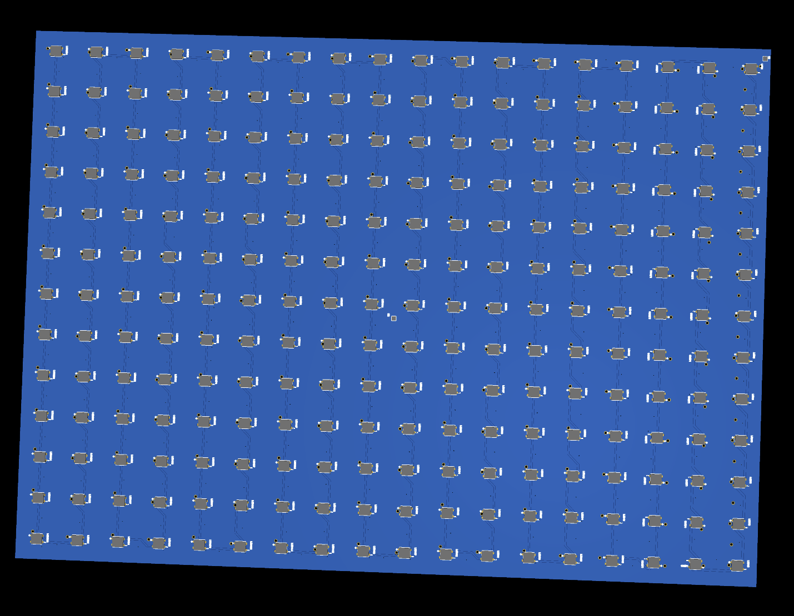

# LED-PANEL

a 13x18 addressable RGB LED panel, built to be driven pixel by pixel from an external controller

*the top side of the board, all 234 leds, rendered from the gerbers in `PCB_FILES/`.*

## What it does

LED-PANEL is a big PCB carrying 234 individually addressable RGB LEDs wired up in a 13 column by 18 row grid. every LED sits on one continuous single-wire data chain, so one controller pin can drive all 234 pixels independently, full RGB, each one on its own. the board itself is just the panel, it has no brain on it, you bring the controller.

the name comes from the actual goal here: watching a movie the way it's meant to be seen, at real framerate, on a panel dense enough to actually output video and not just slow ambient patterns. 100+fps is the target for the finished system, not a measured result yet, since the board hasn't been built.

that target does fit inside the protocol though. a WS2812B-style chain clocks at 800kHz, so 234 LEDs x 24 bits = 5616 bits x 1.25µs = 7.02ms per frame, plus the reset gap at the end, which puts the ceiling around 141fps. that's arithmetic off the protocol timing, not a bench measurement.

## Why i made it

i wanted a real reason to learn pcb design past a single blinky led board, so i picked something with an actual constraint to solve: pack as many individually addressable pixels as i could onto one board that's still manufacturable, route the data chain sanely across all of them, and get the power distribution right so it doesn't sag under load. a 13x18 matrix made routing and power actually hard, and gives me something genuinely useful afterward instead of just a demo.

## How it works

each led footprint has 4 pads: +5V, DIN, DOUT, GND. LED1's DOUT feeds LED2's DIN, LED2's DOUT feeds LED3's DIN, and so on, all 234 LEDs wired as one chain. the routing between rows snakes back and forth (serpentine) so the trace between the last led in a row and the first led in the next row stays short instead of running all the way back across the board every time.

row 1 is LED1 to LED13 running left to right, row 2 is LED14 to LED26 running right to left, row 3 goes left to right again, and it keeps alternating like that down to LED234 in the bottom left corner. so for a pixel at column x, row y (both counting from 0 at the top left), the index in the chain is `y*13 + x` on even rows and `y*13 + (12-x)` on odd rows.

there's a single 470Ω resistor (R1) between the data-in pad (H1) and LED1's DIN, which protects the first led in the chain from signal reflections, pretty standard for this kind of setup. every led also gets its own decoupling cap right next to it.

it's a two sided assembly. the 234 leds sit on the top face, and all 234 decoupling caps plus R1 are on the back, so the front stays a clean grid of nothing but pixels. both layers are flooded with copper pour for the power rails.

there's no connector on this board, and no mcu either. H1 is a single solder pad for your controller's data wire, which goes through R1 into LED1. for +5V there are 248 plated through-hole pads scattered across the whole board, roughly one beside every led plus extras at the row ends, including H2 in the dead centre. that many injection points is deliberate, it lets you feed 5V in at several places at once instead of dragging all the current in from one corner. GND has no dedicated through-hole pad, you solder it to the ground pour.

there are no mounting holes. the largest hole anywhere on the board is 1.0mm, which is a power pad, not something you can put a screw through, so plan on standoffs, tape or a frame if you want to hang it.

## What's on the board

- 234x addressable RGB LEDs (top side), 20mm pitch, 13 columns x 18 rows
- 234x decoupling caps (bottom side), one per led
- 1x 470Ω resistor (R1, bottom side) on the data line
- 1x data-in pad (H1, top left)
- 248x plated through-hole +5V pads, H2 among them
- 2-layer board, 260mm x 360mm, portrait, with roughly a 10mm border around the 240 x 340mm led area

## Hardware

### Schematic

the export above covers LED1 through LED91. the remaining rows are the exact same repeating pattern, so it's cut off rather than shrunk down to unreadable.

### PCB top
shown at the top of this readme.

### PCB bottom

### 3D view

board files (gerbers) are in `PCB_FILES/LED_PANNEL_PCB.zip`.

## Firmware

there's no firmware on the panel itself since there's no mcu on it, `firmware/led_pannel_controller.ino` is a starting-point sketch for an external ESP32 controller using FastLED, mapped to the real 13x18 serpentine chain order. it hasn't been tested on real hardware yet since the board isn't built, and a couple things are still worth double checking once it is: whether the led really wants WS2812B timing and GRB order, and whether a 3.3V esp32 gpio needs a level shifter to drive the data line reliably.

### flashing it

open the sketch in arduino ide, install the **esp32 by Espressif** board package and the **FastLED** library, pick your esp32 board, plug it in over usb, select its com port and hit upload. check `DATA_PIN` in the sketch matches whichever gpio you actually wired to the panel's data line first.

## How to use it

1. wire DATA from your controller to H1, and +5V and GND from your supply to the panel. use several of the +5V pads spread across the board, not just one, and give GND a few solid connections to the pour as well.
2. flash `firmware/led_pannel_controller.ino` to your controller.
3. power the panel from a 5V supply sized for real measured draw, not your controller board's onboard regulator. at the usual 60mA per led for full white, 234 leds works out to about 14A, which is far past anything usb will give you.
4. run the sketch's sweep pattern first to check every led lights up in the right spot before doing anything fancier.

## BOM

full bom is in `BOM.csv`. led is a XINGLIGHT XL-5050RGBC-2812B (LCSC C2843785), decoupling cap is a Samsung CL10B104KB8NNNC 100nF 0603 (LCSC C1591), at 234 qty each that's $11.37 for the leds and $3.51 for the caps, so $14.88 for the priced parts. R1 is a single generic 470Ω 0603 resistor, a cent or so, and it isn't in that subtotal. none of it includes the pcb, and this is a 260 x 360mm board so get a real quote from your fab house since it's bigger than the usual cheap prototyping size.

## Assembly

1. order the pcb using the gerber zip in `PCB_FILES/LED_PANNEL_PCB.zip` (2-layer, 260 x 360mm, confirm your fab house can do this size).
2. solder the 234 leds on the top side, using the silkscreen as a guide.
3. flip the board and solder the 234 decoupling caps and R1 on the bottom side.
4. check the full data chain and the +5V/GND rails with a multimeter before powering up.
5. wire DATA to H1 and +5V/GND to the panel from your external controller and supply.
6. power up at low brightness first and check every led addresses correctly before running it at full brightness.

made by Rudra Puri, 17, India, for Hack Club.
